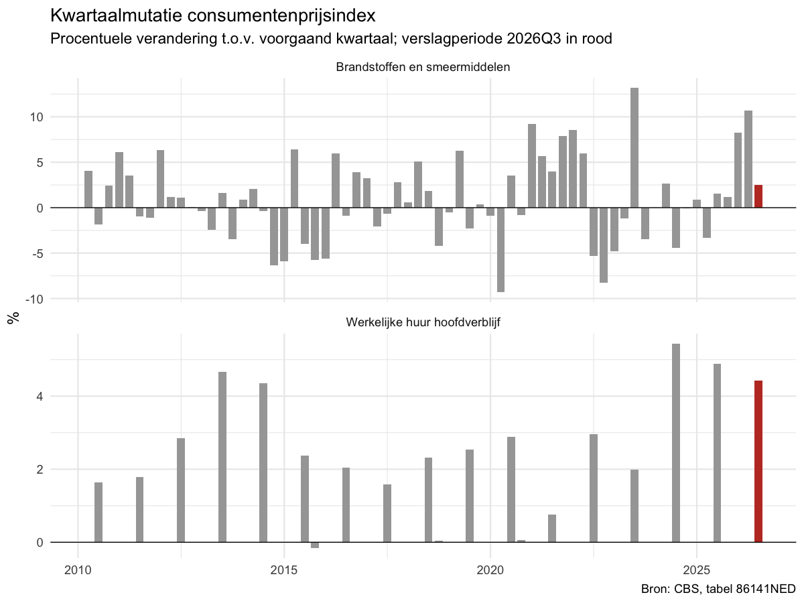
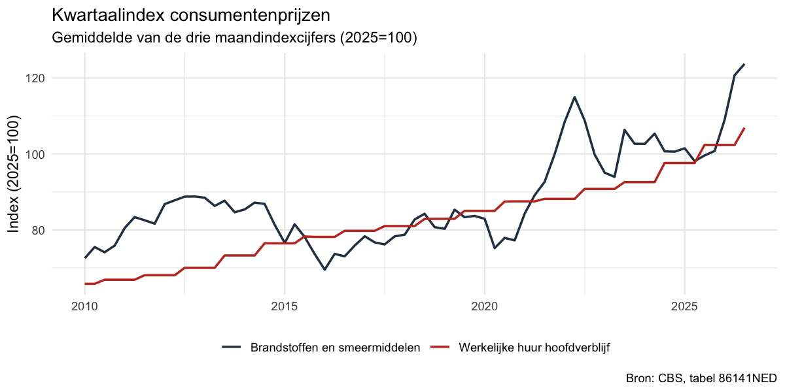

# Kwartaalmutatie consumentenprijzen (CBS StatLine → R → SQLite)

Klein, op zichzelf staand R-proces dat via de CBS Open Data API de maandelijkse
consumentenprijsindex (CPI) ophaalt voor twee producten, daar de **kwartaalmutatie**
van berekent, grafieken maakt en alles opslaat in een lokale SQLite-database.

| Product | CBS-code | Waarom |
|---|---|---|
| Brandstoffen en smeermiddelen | `CPI072200` | Volatiel: beweegt mee met de olieprijs, grote uitslagen per kwartaal |
| Werkelijke huur hoofdverblijf | `CPI041100` | Stapsgewijs: huren worden per 1 juli aangepast, dus drie kwartalen vrijwel vlak en één met een sprong |

Dat contrast laat zien wat een kwartaalmutatie wel en niet zegt: bij huur is de
mutatie van een enkel kwartaal vooral een kalendereffect, bij brandstof een
marktbeweging.

## Resultaat (verslagperiode 2026Q3, CBS-stand van 13 oktober 2026)

| Product | Kwartaalindex 2026Q3 | Kwartaalindex 2026Q2 | Kwartaalmutatie |
|---|---|---|---|
| Brandstoffen en smeermiddelen | 123,71 | 120,71 | **+2,5%** |
| Werkelijke huur hoofdverblijf | 106,91 | 102,38 | **+4,4%** |

September 2026 is door CBS nog als **voorlopig** gemarkeerd, dus beide cijfers zijn
voorlopig. Het proces neemt die status over in de database (kolom `voorlopig`).
CBS kan cijfers achteraf bijstellen; een nieuwe run kan dus iets andere waarden geven.




De panelen van de mutatiegrafiek hebben elk een eigen y-as: vergelijk de vorm, niet de
hoogte van de staven.

## Tooling en gebruik

R 4.6.1 met `cbsodataR` (CBS-data via OData), `DBI` + `RSQLite` (opslag), `ggplot2`
(grafieken) en `testthat` (tests).

```bash
Rscript install_dependencies.R          # eenmalig
Rscript main.R 2026Q3                   # verslagperiode (JJJJQk) is verplicht; vereist internet
Rscript -e 'testthat::test_dir("tests/testthat")'
```

## Proces: input → throughput → output

```
CBS Open Data API (tabel 86141NED)
        │  R/input.R        haal_cpi_maandcijfers()
        ▼
maandcijfers (data.frame)
        │  R/throughput.R   bereken_kwartaalindex()
        │                   bereken_kwartaalmutaties()
        │                   bereken_kwartaalmutatie(maand, verslagperiode)
        ▼
kwartaalindex en -mutaties
        │  R/output.R       maak_grafieken()  → output/*.png
        │                   schrijf_sqlite()  → output/cpi.sqlite
        ▼
resultaat
```

| Bestand | Rol |
|---|---|
| `main.R` | Startpunt |
| `R/config.R` | Tabel-ID, productcodes en paden op één plek |
| `R/input.R` | Ophalen uit de API, geen csv/excel |
| `R/throughput.R` | Berekening; pure functies zonder netwerk of bestanden |
| `R/output.R` | Grafieken en SQLite |
| `R/pipeline.R` | Verbindt de drie stappen |
| `tests/testthat/` | Tests |

### Berekening

1. **Kwartaalindex** = gemiddelde van de drie maandindexcijfers van het kwartaal,
   per product.
2. **Kwartaalmutatie** = (index kwartaal *t* / index kwartaal *t−1* − 1) × 100.

De functie is `bereken_kwartaalmutatie(maand, verslagperiode)`, met de verslagperiode
als tekst in het formaat `JJJJQk`, bijvoorbeeld `"2026Q3"`.

Om foutieve cijfers te voorkomen:

- Alleen **volledige kwartalen** (drie maanden met een waarde) tellen mee. Is de
  verslagperiode voor een van de producten onvolledig, dan volgt een foutmelding, geen
  vertekend gemiddelde of een resultaat met maar één product.
- Het voorgaande kwartaal wordt op kwartaalnummer gezocht, niet als "vorige rij". Een
  gat in de reeks wordt daardoor niet stilzwijgend overbrugd.
- Een ongeldige invoer (`"2026-Q3"`, `"2026Q5"`) of een periode zonder data
  (`"2027Q1"`) stopt het proces met een duidelijke melding.

## Keuzes in de data

**Niveau: klassen.** De CBS-tabel kent de bestedingscategorieën op meerdere niveaus:
afdelingen (15), groepen (53), klassen (114), subklassen (175) en microklassen (5).
Beide producten zijn klassen (COICOP, 4 cijfers). De zescijferige CBS-code is daarom
aangevuld met nullen: `0722` + `00` en `0411` + `00`. Op afdelingsniveau middelen
bewegingen elkaar uit (brandstof valt dan onder "Vervoer", samen met auto's en
openbaar vervoer) en verdwijnt het contrast tussen beide producten. Subklassen en
microklassen zijn specifieker, maar minder representatief en gevoeliger voor ruis.

**Indexreeks: `CPI`, niet `CPI afgeleid`.** De tabel bevat twee reeksen. Dit proces
gebruikt `CPI` (kolom `CPI_1`), waarin ook belastingen en subsidies meetellen: de prijs
die huishoudens werkelijk betalen. `CPI afgeleid` (`CPIAfgeleid_2`) laat veranderingen
in btw, accijns en subsidies buiten beschouwing. Voor huur zijn ze gelijk, voor
brandstof niet (september 2026: 128,27 tegenover 125,01). Wie het prijsverloop zonder
belastingeffecten wil, zet `INDEX_KOLOM` in `R/config.R` op `"CPIAfgeleid_2"`.

**Tabel: 86141NED.** Per 2026 publiceert CBS de CPI met basisjaar 2025=100 en een
nieuwe productindeling. De oudere tabel 83131NED (2015=100) loopt tot en met 2025 en
gebruikt een andere indeling; cijfers uit beide tabellen niet mengen.

## Opslag

`output/cpi.sqlite` bevat drie tabellen:

| Tabel | Inhoud |
|---|---|
| `cpi_maand` | Opgehaalde maandcijfers (inclusief `voorlopig`) |
| `cpi_kwartaal` | Kwartaalindex, vorig kwartaal, mutatie in % |
| `runs` | Logboek: tijdstip, tabel-ID en verslagperiode van elke run |

`cpi_maand` en `cpi_kwartaal` worden bij elke run vervangen, dus twee keer draaien
geeft dezelfde inhoud. `runs` wordt aangevuld. De database staat in `.gitignore`; de
grafieken in `output/` zijn wel meegecommit.

## Tests

De tests (testthat, synthetische data, geen netwerk) richten zich op de rekenregel en
de randgevallen waar een fout het meest voor de hand ligt: de formule zelf, een
onvolledig kwartaal, een ontbrekend product, een gat in de reeks, de jaarwisseling
(Q4 → Q1) en een ongeldige verslagperiode. Verder is getest dat de CBS-periodecode en
de status `voorlopig` goed worden gelezen en dat wegschrijven naar SQLite idempotent
is. De API-call en de grafieken zelf zijn niet getest.

## Beperkingen en vervolgstappen

- **Geen seizoenscorrectie.** De mutaties zijn ongecorrigeerd, dus een seizoens- of
  kalenderpatroon (zoals de huuraanpassing in Q3) zit in het cijfer.
- **Geen historie van bijstellingen.** Elke run overschrijft de cijfers; `runs` legt
  alleen vast wanneer er gedraaid is. Oude publicatiestanden bewaren kan door een kolom
  met de ophaaldatum toe te voegen en rijen aan te vullen in plaats van te vervangen.
- **Afronding.** CBS publiceert indexcijfers met twee decimalen en het kwartaalgemiddelde
  wordt op die afgeronde maandcijfers berekend. De tweede decimaal van de mutatie kan
  daardoor afwijken van een berekening op niet-afgeronde data.
- **API.** `cbsodataR` gebruikt de oudere OData-API van CBS; het opvolgende pakket
  `cbsodata4` gebruikt OData4. Overstappen raakt alleen `R/input.R`.
- **Reproduceerbaarheid.** Pakketversies zijn niet vastgelegd. Logische volgende stap:
  `renv` (lockfile) en een CI-workflow die de tests draait.
